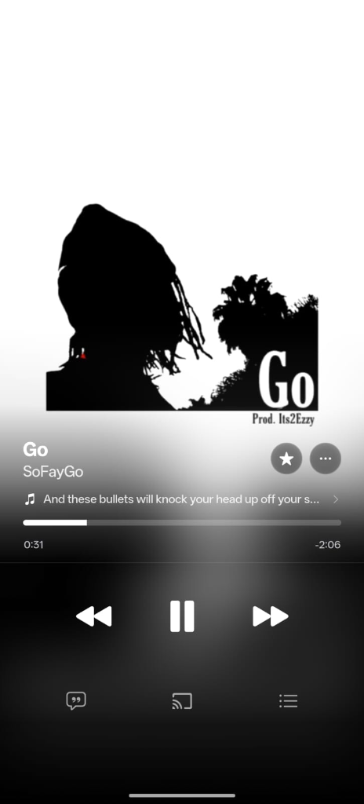
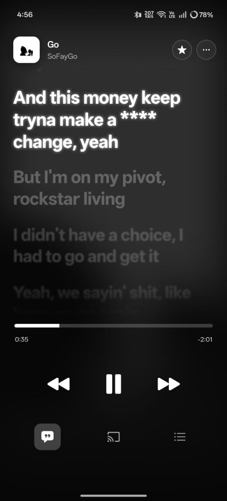
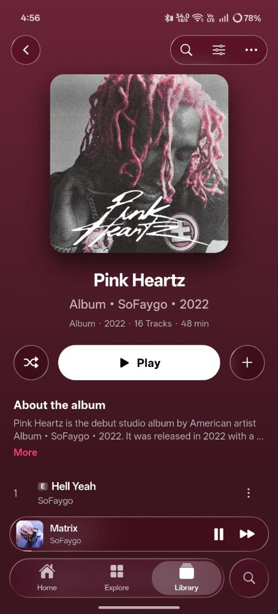
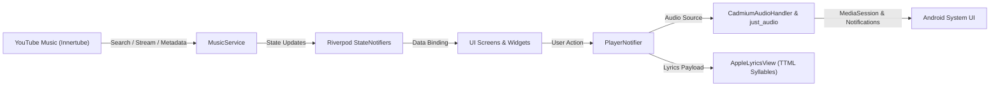

<div align="center">

  

  # Cadmium

  ### *The Pure, High-Fidelity Apple Music Experience for Android*

  <p align="center">
    A modern, high-performance music streaming client engineered with Flutter.<br/>
    Combining the refined minimalism of <b>Apple Music</b> with the massive catalog of <b>YouTube Music Innertube</b> — featuring OLED pitch-black styling, word-by-word synced TTML lyrics, and zero-latency audio playback.
  </p>

  <p align="center">
    <a href="https://github.com/dev-o-los/cadmium/releases/latest">
      
    </a>
    <a href="https://github.com/dev-o-los/cadmium/releases/latest">
      
    </a>
  </p>

  <p align="center">
    
    
    
    
    
  </p>

  <p align="center">
    <a href="#-app-showcase">Showcase</a> •
    <a href="#-quick-download--installation">Quick Download</a> •
    <a href="#-how-to-install-the-apk">How to Install</a> •
    <a href="#-key-features">Features</a> •
    <a href="#-architecture">Architecture</a> •
    <a href="#-building-from-source">Build from Source</a>
  </p>

</div>

---

## 📱 App Showcase

Experience the fluid Apple Music interface recreated with pixel precision:

<div align="center">
<table>
  <tr>
    <td width="33.3%" align="center">
      
      <br/>
      <sub><b>Full Player & Live Lyrics Ticker</b></sub>
    </td>
    <td width="33.3%" align="center">
      
      <br/>
      <sub><b>Syllable-by-Syllable Karaoke Lyrics</b></sub>
    </td>
    <td width="33.3%" align="center">
      
      <br/>
      <sub><b>Album Tracklist & Liquid Mini Player</b></sub>
    </td>
  </tr>
</table>
</div>

---

## ⚡ Quick Download & Installation

The buttons and links below navigate to the official GitHub Releases where you can always get the latest versioned `cadmium-*.apk`:

<div align="center">

| Package | Version | Architecture | Download Link |
| :--- | :--- | :--- | :--- |
| **Latest Cadmium APK** | **v1.0.1** | `arm64-v8a`, `armeabi-v7a`, `x86_64` | [**Download cadmium-v1.0.1.apk**](https://github.com/dev-o-los/cadmium/releases/download/v1.0.1/cadmium-v1.0.1.apk) |
| **GitHub Releases** | All Versions | Universal | [**View Latest Release Page**](https://github.com/dev-o-los/cadmium/releases/latest) |

</div>

> 💡 **Tip:** Official release binaries are exclusively named **`cadmium-v<version>.apk`** (e.g., `cadmium-v1.0.1.apk`). Visiting the [GitHub Releases](https://github.com/dev-o-los/cadmium/releases/latest) page will always redirect you directly to the latest release notes and assets.

---

## 📥 How to Install the APK

Follow these quick steps to get Cadmium running on your phone in under a minute:

1. **Download the APK**:
   Tap [**Download cadmium-v1.0.1.apk**](https://github.com/dev-o-los/cadmium/releases/download/v1.0.1/cadmium-v1.0.1.apk) or open the [GitHub Releases](https://github.com/dev-o-los/cadmium/releases/latest) page and select the latest `cadmium-v*.apk` under **Assets**.
2. **Confirm Download**:
   If your browser displays *"File might be harmful"* (standard Android warning for apps downloaded outside Google Play), tap **Download anyway**.
3. **Allow Installation**:
   Open the downloaded APK from your notifications or File Manager. If prompted with *"Install unknown apps"*, tap **Settings** and toggle **Allow from this source**.
4. **Install & Enjoy**:
   Tap **Install**, launch **Cadmium**, and start streaming your favorite tracks in high fidelity!

---

## ✨ Key Features

### 🍎 Authentic Apple Music Aesthetics
* **OLED Pitch-Black Design (`#000000`)**: Engineered specifically for AMOLED and OLED panels for deep contrasts and optimal power efficiency.
* **SF Pro Typography & Tracking**: Replicates Apple's exact typography scale, tracking ratios, and font weights.
* **Liquid Glass & Frosted Blur**: Translucent bottom sheets, rounded action cards, subtle dividers, and responsive grabbers with real-time blur shaders.
* **Fluid Hero Animations**: Seamless artwork expansion transitioning between the floating mini player and the expanded player screen using custom cubic curves.

### 🎵 High-Fidelity Streaming & Background Playback
* **YouTube Music Innertube Catalog**: Access millions of official songs, albums, singles, artist discographies, and playlists without ads.
* **OS Media Notification & Lock Screen**: Full Android media player in the notification bar and quick settings shade, complete with scrub bar, artwork, and lock screen controls.
* **Persistent Background Playback**: Engineered to keep playing smoothly when your phone is locked or minimized without being terminated by OS battery optimization.
* **Fast Audio Pre-Caching**: Frequently heard tracks are automatically cached to local storage for instantaneous 0ms playback and reduced mobile data consumption.

### 🎤 Syllable-Level Karaoke Lyrics
* **Word-by-Word Real-Time Animations**: Synced via Apple TTML and `lrc.red` engines, glowing syllable-by-syllable alongside the artist's vocals.
* **Interactive Tap-to-Seek**: Tap any lyric line or syllable to immediately scrub playback to that exact vocal moment.
* **Smart Multi-Engine Fallback**: Cascades dynamically from syllable-level TTML to line-synced LRC, and falls back gracefully to plain text lyrics if timestamps are absent.

### 🎨 Dynamic Artwork & Colors
* **Multi-Tier Artwork Resolution**: Cascades automatically to fetch the highest possible resolution (`maxresdefault` → `sddefault` → `hqdefault` → thumbnail).
* **Ambient Mesh Gradients**: Extracts the dominant color accents from the active album cover to paint subtle ambient background reflections.

---

## 🏗️ Architecture

Cadmium is built with **Flutter 3.x** and **Riverpod 2.x** state management following clean architecture principles:

```
lib/
├── constants/         # Apple typography scale, OLED palette & styles
├── models/            # Immutable domain models (Song, Album, Artist, Lyrics)
├── providers/         # Riverpod StateNotifiers (Player, Library, Navigation)
├── screens/           # Core views (HomeFeed, Player, Album, Artist, Search, Library)
├── services/          # Streaming engine, AudioHandler, Lyrics parser, Artwork caches
└── widgets/           # Liquid glass bottom bar, Apple lyrics canvas, Player controls
```

### Data & Playback Flow



---

## 🛠️ Tech Stack

| Library | Purpose |
| :--- | :--- |
| **[flutter_riverpod](https://pub.dev/packages/flutter_riverpod)** | Compile-safe reactive state management |
| **[just_audio](https://pub.dev/packages/just_audio)** | Low-latency audio streaming & caching engine |
| **[audio_service](https://pub.dev/packages/audio_service)** | Android MediaSession & system notification player |
| **[liquid_glass_widgets](https://pub.dev/packages/liquid_glass_widgets)** | Real-time GPU shaders for liquid frosted glass |
| **[cached_network_image](https://pub.dev/packages/cached_network_image)** | Multi-tier memory and disk image caching |
| **[palette_generator](https://pub.dev/packages/palette_generator)** | Dynamic color extraction for ambient player mesh backgrounds |

---

## 💻 Building from Source

If you want to contribute or compile the project locally:

### Prerequisites
* **Flutter SDK**: `^3.13.0` or higher ([Flutter Install Guide](https://docs.flutter.dev/get-started/install))
* **Dart SDK**: `^3.13.3`
* **JDK**: Java 17 or Java 21
* **Android Studio / Android SDK**

### Setup & Run

```bash
# 1. Clone repository
git clone https://github.com/dev-o-los/cadmium.git
cd cadmium

# 2. Install dependencies
flutter pub get

# 3. Run static analyzer and test suite
flutter analyze
flutter test

# 4. Run on your connected device
flutter run
```

### Build Universal Release APK

```bash
flutter build apk --release
```
The output APK will be generated at `build/app/outputs/flutter-apk/app-release.apk`.

---

## 🧪 Automated Testing

Cadmium includes automated unit, widget, and integration test coverage:

```bash
flutter test
```

* **129 Passing Automated Tests** covering:
  - TTML and lrc.red syllable-level lyrics parsers
  - Audio stream resolution and auto-recovery fallbacks
  - MediaSession background notifications and controls
  - Liquid glass Cupertino components and touch responses
  - High-precision lyric clock synchronization

---

## 📄 License

This project is licensed under the terms of the **MIT License**.

```
MIT License
Copyright (c) 2026 dev-o-los

Permission is hereby granted, free of charge, to any person obtaining a copy
of this software and associated documentation files (the "Software"), to deal
in the Software without restriction, including without limitation the rights
to use, copy, modify, merge, publish, distribute, sublicense, and/or sell
copies of the Software...
```

See the full text in the [`LICENSE`](LICENSE) file.

<div align="center">
  <sub>Crafted with passion for music, typography, and precision design.</sub>
</div>
