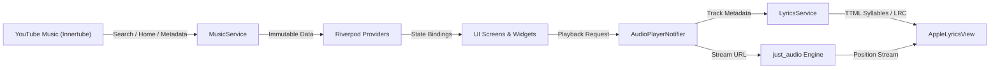

<div align="center">

  

  # Cadmium

  ### *The Pure, High-Fidelity Apple Music Experience for Android & iOS*

  [](https://flutter.dev)
  [](https://dart.dev)
  [](https://github.com/dev-o-los/wavify)
  [](https://github.com/dev-o-los/wavify/releases)
  [](LICENSE)
  [](https://github.com/dev-o-los/wavify)

  <p align="center">
    <b>Cadmium</b> is a modern, high-performance music streaming client engineered with Flutter. Combining the refined minimalism of <b>Apple Music</b> with the catalog of <b>YouTube Music Innertube</b>, Cadmium delivers zero-lag audio playback, word-by-word synced TTML lyrics, and an OLED pitch-black interface.
  </p>

  <p align="center">
    <a href="#-quick-download">Download APK</a> •
    <a href="#-key-features">Features</a> •
    <a href="#-architecture--how-it-works">Architecture</a> •
    <a href="#-tech-stack">Tech Stack</a> •
    <a href="#-getting-started">Build from Source</a>
  </p>

</div>

---

## ⚡ Quick Download

Download the latest release for Android directly from GitHub:

* **[Download Cadmium v1.0.0 APK](https://github.com/dev-o-los/wavify/releases/latest)** (`app-release.apk`)

> Supports **Android 7.0 (API 24)** and above across `arm64-v8a`, `armeabi-v7a`, and `x86_64` architectures.

---

## ✨ Key Features

### 🍎 Authentic Apple Music Design Language
- **OLED Pure Black Theme (`#000000`)**: Tailored specifically for modern OLED and AMOLED displays to maximize contrast and battery life.
- **Cupertino & SF Pro Typography**: Standardized font weights, tracking, and letter-spacing replicating Apple Music's design standards.
- **Frosted Acrylic & Glass Elements**: Translucent bottom sheets, rounded action cards, subtle dividers, and responsive grabbers.
- **Seamless Hero Morph Animations**: Album art transitions smoothly between the floating mini player and the expanded full-screen player using custom cubic bezier curves.

### 🎵 High-Fidelity Audio Streaming Pipeline
- **YouTube Music Innertube Integration**: Access millions of official tracks, albums, artist discographies, music videos, and user playlists without intrusive ads.
- **Low-Latency Playback Engine**: Powered by `just_audio` with audio pre-caching, smart buffer management, and gapless transition capabilities.
- **System Media Notifications**: Full background audio playback with lock screen controls, interactive scrub bars, and dynamic artwork broadcast to the OS notification center.

### 🎤 Syllable-Level Synced Karaoke Lyrics
- **Apple-Style Word-by-Word Animation**: Powered by Apple TTML and `lrc.red` parser integrations, lyrics highlight dynamically syllable-by-syllable in real-time as the song plays.
- **Interactive Auto-Scroll & Seeking**: Tap on any lyric line or syllable to scrub playback immediately to that timestamp.
- **Dual-Engine Lyric Fallback**: Automatically cascades from syllable-synced TTML to line-synced LRC, and finally to un-synced plain text when timestamps are unavailable.

### 🎨 Intelligent Dynamic Artwork & Multi-Tier Caching
- **Cascading Fallbacks**: Automatically fetches the highest possible resolution (`maxresdefault` → `sddefault` → `hqdefault` → YouTube video thumbnail).
- **Zero-Latency Disk Cache**: Cached artworks load instantly in 0ms from local storage, eliminating unnecessary bandwidth and network requests.
- **Real-Time Mesh Gradients**: Extracts the dominant color accents from the active album cover to paint subtle ambient background reflections.

### 📚 Curated Personal Library
- **Account Integration**: Sign in to your YouTube Music account via secure Cookie session to access your personal playlists, subscribed artists, and saved albums.
- **Liked Music & Favorites**: Dedicated, clean playlists section with streamlined metadata free of redundant tags.
- **Unified Search**: Instant predictive search suggestions with categorized results for Songs, Artists, Albums, and Community Playlists.

---

## 🏗️ Architecture & How It Works

Cadmium is engineered with **Riverpod 2.x** state management following clean architecture principles:

```
lib/
├── constants/             # Apple SF typography, OLED color palette & styles
│   ├── app_colors.dart
│   └── apple_typography.dart
├── models/                # Immutable domain models (Song, Album, Artist, Lyrics)
│   ├── song.dart
│   ├── album_item.dart
│   ├── playlist_item.dart
│   └── lyrics_line.dart
├── providers/             # Riverpod providers managing application state
│   ├── audio_player_provider.dart
│   ├── library_provider.dart
│   ├── lyrics_provider.dart
│   └── music_provider.dart
├── screens/               # Core application views
│   ├── home_screen.dart        # Main scaffold with persistent player bar
│   ├── home_feed_screen.dart   # Editorial feed, quick picks & top carousels
│   ├── player_screen.dart      # Full-screen player with lyrics canvas
│   ├── search_screen.dart      # Predictive search & browse categories
│   ├── library_screen.dart     # User playlists, liked songs & subscriptions
│   ├── album_screen.dart       # Detailed album/playlist tracklist & actions
│   ├── artist_screen.dart      # Hero header, top songs, and discography
│   ├── settings_screen.dart    # Apple-style preferences & cache tools
│   └── splash_screen.dart      # Minimalist branded splash screen
├── services/              # External APIs, playback engine & cache storage
│   ├── music_service.dart      # YouTube Music Innertube API client
│   ├── audio_service.dart      # just_audio streaming & notification controller
│   ├── lyrics_service.dart     # TTML syllable parser & lrc.red integration
│   └── artwork_cache_service.dart # Local file & LRU memory artwork cache
└── widgets/               # Modular reusable UI components
    ├── wavify_cached_image.dart# Cascading high-performance network image loader
    ├── player_controls.dart    # Scrub bar, play/pause & track controls
    ├── apple_lyrics_view.dart  # Syllable-level dynamic lyrics renderer
    ├── track_options_sheet.dart# Cupertino-style contextual action sheets
    └── account_modal_sheet.dart# Profile avatar modal with quick settings
```

### Data Flow Overview



---

## 🛠️ Tech Stack & Dependencies

| Library | Version | Purpose |
| :--- | :--- | :--- |
| **[flutter_riverpod](https://pub.dev/packages/flutter_riverpod)** | `^2.6.1` | Declarative, compile-safe reactive state management |
| **[just_audio](https://pub.dev/packages/just_audio)** | `^0.9.46` | High-fidelity audio playback and streaming engine |
| **[audio_service](https://pub.dev/packages/audio_service)** | `^0.18.18` | OS-level media notifications and background playback control |
| **[cached_network_image](https://pub.dev/packages/cached_network_image)** | `^3.4.1` | Multi-tier memory and disk image caching |
| **[flutter_animate](https://pub.dev/packages/flutter_animate)** | `^4.5.2` | Fluid physics-based hero transitions and micro-interactions |
| **[palette_generator](https://pub.dev/packages/palette_generator)** | `^0.3.3` | Dynamic color extraction for ambient player mesh backgrounds |
| **[cupertino_icons](https://pub.dev/packages/cupertino_icons)** | `^1.0.8` | Standard Apple SF iconography set |
| **[shared_preferences](https://pub.dev/packages/shared_preferences)** | `^2.5.3` | Persistent storage for settings, auth cookies, and cached data |
| **[crypto](https://pub.dev/packages/crypto)** | `^3.0.6` | SHA-256 deterministic key generation for cache files |

---

## 💻 Getting Started

### Prerequisites

Ensure your development environment meets the following requirements:
- **Flutter SDK**: `^3.13.0` or higher ([Install Flutter](https://docs.flutter.dev/get-started/install))
- **Dart SDK**: `^3.13.3`
- **JDK**: Java 17 or Java 21
- **Android Studio / Xcode**: For mobile deployment and simulator support

### Installation & Run

1. **Clone the repository**:
   ```bash
   git clone https://github.com/dev-o-los/wavify.git
   cd wavify
   ```

2. **Install Flutter dependencies**:
   ```bash
   flutter pub get
   ```

3. **Run code analysis and tests**:
   ```bash
   flutter analyze
   flutter test
   ```

4. **Launch the application**:
   ```bash
   # Run on connected Android / iOS device or simulator
   flutter run
   ```

### Building Release Artifacts

To compile an optimized, signed release build for Android:

```bash
# Build Universal Release APK
flutter build apk --release

# Build Split per-ABI APKs (Smaller download sizes)
flutter build apk --split-per-abi

# Build Google Play App Bundle (.aab)
flutter build appbundle --release
```

Output APK will be available at `build/app/outputs/flutter-apk/app-release.apk`.

---

## 🧪 Testing & Reliability

The codebase features comprehensive unit, widget, and integration test coverage:

```bash
flutter test
```

- **126 Automated Unit & Widget Tests**:
  - Lyrics syllable parsing (`TTML`, `lrc.red`, clock formats)
  - Audio stream resolution and fallback chains
  - Liquid glass modal sheets and Cupertino interaction mechanics
  - Artwork morph hero animation curves
  - Dynamic cache cascade validation (`maxresdefault` down to placeholder)

---

## 🤝 Contributing

Contributions are warmly welcomed! If you'd like to contribute:

1. Fork the repository.
2. Create a feature branch (`git checkout -b feature/AmazingFeature`).
3. Commit your changes (`git commit -m 'feat: add some amazing feature'`).
4. Ensure all tests and static analysis pass (`flutter analyze && flutter test`).
5. Push to your branch (`git push origin feature/AmazingFeature`).
6. Open a Pull Request.

---

## 📄 License

Distributed under the **MIT License**. See [`LICENSE`](LICENSE) for more information.

---

<div align="center">
  <sub>Crafted with passion for music and precision design.</sub>
</div>
